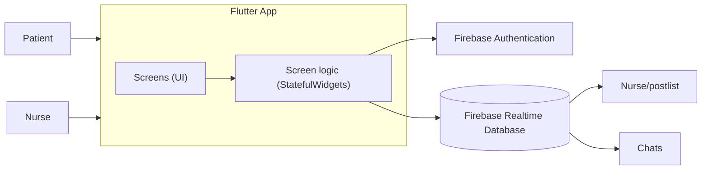
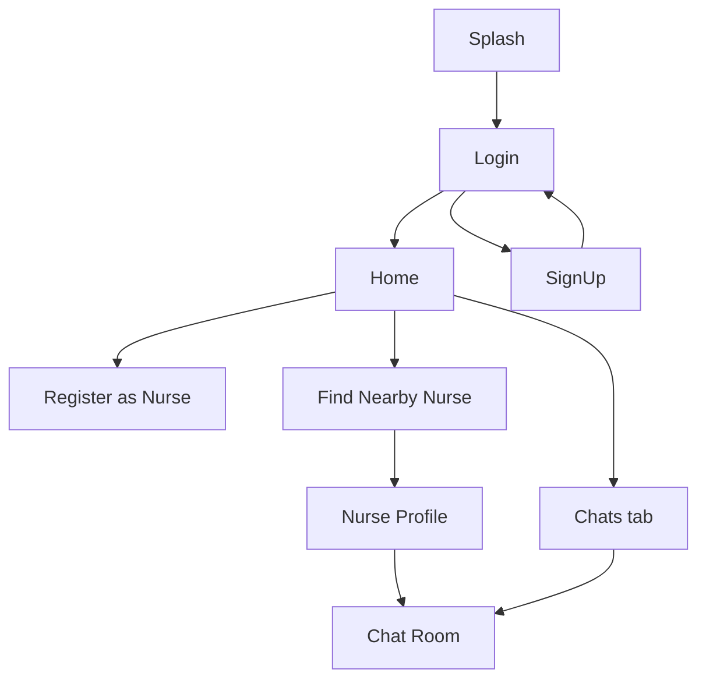

# Architecture Draft

Initial architecture overview for the **Patient Care – Nurse Connect** app.

## 1. Overview

The system is a Flutter mobile app that talks directly to Firebase. There is no custom server: Firebase Authentication handles users, and Firebase Realtime Database stores nurse profiles and chat messages.

Two kinds of users share the same app:

- **Patient:** searches for nurses and sends messages.
- **Nurse:** registers a profile, receives messages and replies.




## 3. App Layers

| Layer | Responsibility | Files |
|-------|----------------|-------|
| Entry | Starts the app and Firebase | `main.dart` |
| Onboarding | Splash, login, sign up | `splash_screen.dart`, `login_screen.dart`, `sign_up_page.dart` |
| Main navigation | Bottom bar with Home and Chats tabs | `home_screen.dart` |
| Nurse features | Register nurse, search nurses, view profile | `nurse_registertion.dart`, `recive_nurse_data.dart`, `search_nearset_nurse.dart` |
| Messaging | Chats list and chat room | `chats_list_screen.dart`, `chat_room_screen.dart`, `chat_screen.dart` |

## 4. Screen Flow



## 5. Data Model (Firebase Realtime Database)

### Nurse profiles

```
Nurse
└── postlist
    └── <id>
        ├── uid          (nurse's login ID)
        ├── pname        (name)
        ├── peducation   (education)
        ├── plocation    (location)
        ├── pcontact     (phone number)
        └── pImage       (photo URL)
```

### Chats

One room per nurse and patient pair. The room ID is `<nurseUid>_<patientUid>`.

```
Chats
└── <nurseUid>_<patientUid>
    └── <messageId>
        ├── message
        ├── senderUid
        ├── senderEmail
        └── time
```

## 6. Key Data Flows

**Sending a message**

1. Patient opens a nurse profile and taps *Chat With Nurse*.
2. The app builds the room ID from the nurse's `uid` and the patient's login ID.
3. The message is saved under `Chats/<roomId>`.
4. Both users see it instantly because the chat screens listen to that room.

**Nurse seeing her messages**

1. The Chats tab reads all rooms.
2. It keeps only rooms where the logged-in user's ID is part of the room ID.
3. It shows the last message, time and the other person's name and photo.

## 7. Known Limitations and Next Steps

- The Chats list reads all chats and filters on the device. A per-user chat index would scale better.
- Database security rules still need to be tightened so users can only read their own chats.
- No unread counters or push notifications yet.
- Nurse search filters by typed location only (no GPS or map).
- Add automated tests for the main screens.