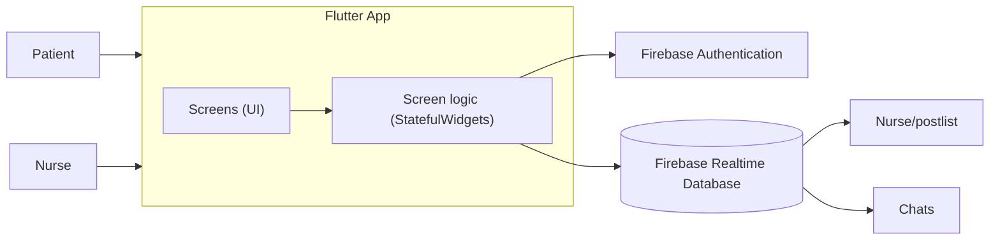
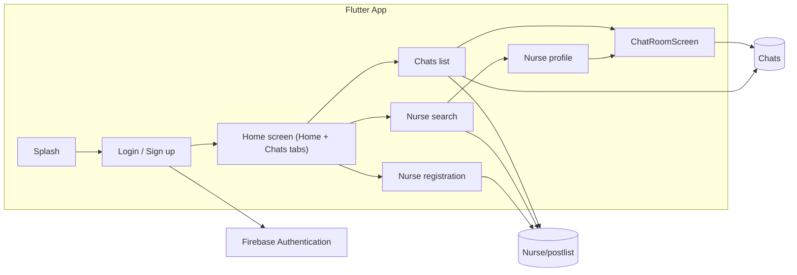
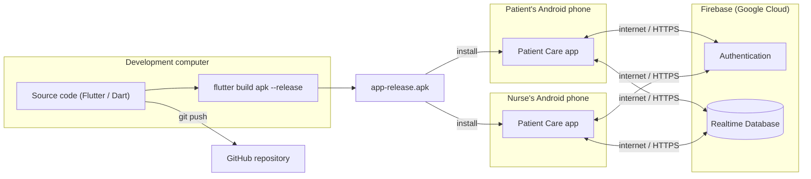
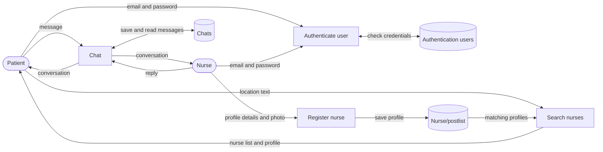
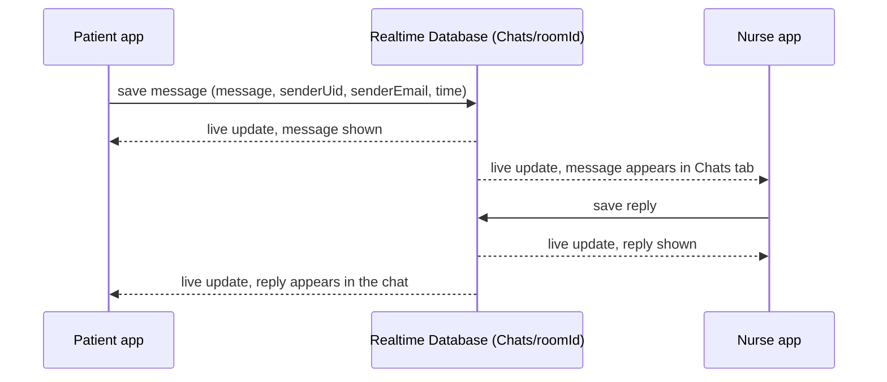

# Architecture Diagrams

All four diagrams for the **Patient Care – Nurse Connect** app in one place. GitHub draws them automatically.

1. [System Architecture](#1-system-architecture)
2. [Component Diagram](#2-component-diagram)
3. [Deployment Diagram](#3-deployment-diagram)
4. [Data Flow Diagram](#4-data-flow-diagram)

---

## 1. System Architecture

The Flutter app talks directly to Firebase. There is no custom server.

---

## 2. Component Diagram

The screens inside the app and the Firebase parts each one uses.

---

## 3. Deployment Diagram

How the app moves from the source code to users' phones, and which cloud services it connects to at run time.

| Node | What runs there |
|------|-----------------|
| Development computer | Flutter SDK, VS Code, Git, tests (`flutter test`) |
| GitHub | Source code, documentation and the project board |
| Android phones | The installed app (patient and nurse use the same app) |
| Firebase | User accounts (Authentication) and all stored data (Realtime Database) |

---

## 4. Data Flow Diagram

### 4.1 Overview: who sends what to which store

### 4.2 Sending a message (step by step)

The room ID is `<nurseUid>_<patientUid>`, so both users always read and write the same conversation.