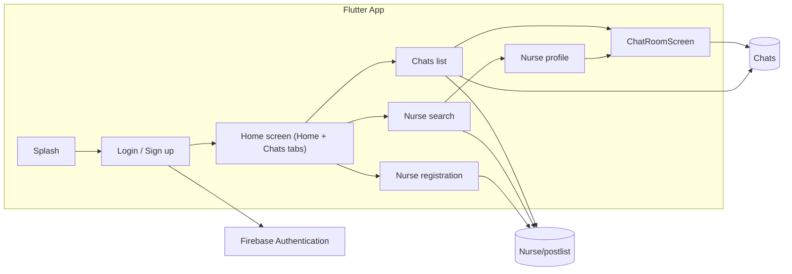

# Architecture Update – Milestone 2 (MVP)

This document updates the [initial architecture draft](ARCHITECTURE.md) now that the first working end-to-end version of the app exists.

## 1. What Changed Since the Draft

| Area | Draft (Milestone 1) | Now (Milestone 2) |
|------|---------------------|-------------------|
| Navigation | Single home screen | Home screen with a bottom bar: **Home** and **Chats** tabs |
| Chat | Planned as one chat screen | One reusable `ChatRoomScreen` used by both patient and nurse |
| Nurse messages | Planned as a separate nurse inbox | Replaced by a WhatsApp-style **Chats list** that works for both roles |
| UI | Different colours per screen | One shared teal design across all screens |
| Profile photos | Not designed | Shown in nurse cards, nurse profile and chat headers, with fallbacks if a photo fails to load |

## 2. Updated Component Diagram

## 3. Implementation Status

| Component | Status |
|-----------|--------|
| Splash screen | Implemented |
| Sign up and login (Firebase Authentication) | Implemented |
| Home screen with bottom navigation | Implemented |
| Nurse registration | Implemented |
| Nurse search by location | Implemented |
| Nurse profile | Implemented |
| Real-time chat (patient and nurse) | Implemented |
| Chats list for both roles | Implemented |
| Database security rules | Planned |
| Unread counts and push notifications | Planned |
| GPS / map-based search | Planned |
| Automated tests | Planned |

## 4. Core End-to-End Workflow

1. A nurse signs up and registers a profile.
2. A patient signs up, searches by location and opens the nurse's profile.
3. The patient taps **Chat With Nurse** and sends a message.
4. The nurse opens the **Chats** tab, sees the patient's message and replies.
5. The patient sees the reply instantly in the same conversation.

## 5. Design Decisions

- **No custom backend.** Firebase Authentication and Realtime Database are enough for the MVP and keep the project simple.
- **One chat room per nurse and patient pair.** The room ID is `<nurseUid>_<patientUid>`, so both sides always open the same conversation.
- **One chat screen for both roles.** The same `ChatRoomScreen` is used by patients and nurses, which avoids duplicate code.
- **Nested live streams in the Chats list.** One stream reads nurse names and photos, another reads the chats, so the list updates in real time.

## 6. Known Limitations and Planned Changes

| Limitation | Planned change |
|------------|----------------|
| The Chats list reads all chats and filters them on the device. | Add a per-user chat index so each user only reads their own chats. |
| Database rules are still open for development. | Restrict reads and writes so users can only access their own chats. |
| No unread counters or push notifications. | Track last-seen time per chat and add Firebase Cloud Messaging. |
 | Add widget tests for the main screens. |